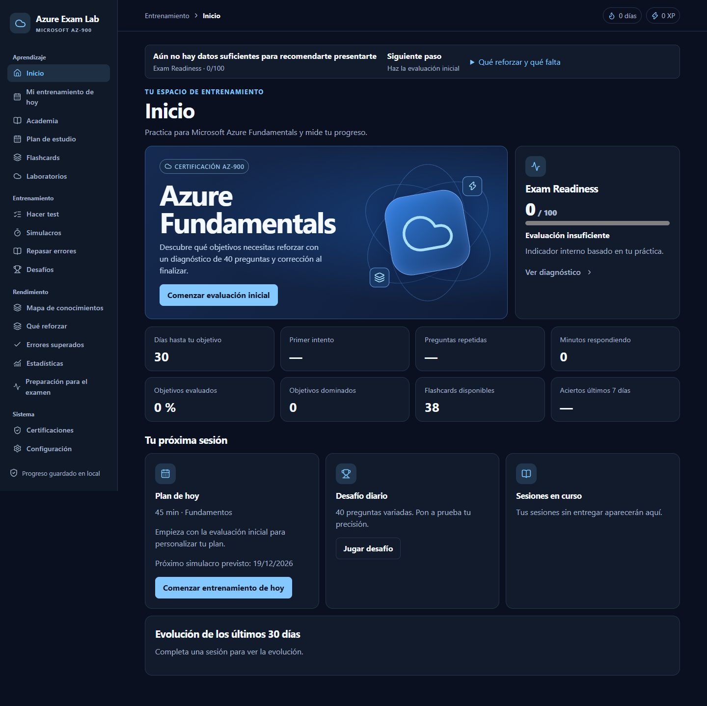

# Azure Exam Lab 3.0

Entrenamiento local en español para Microsoft Azure Fundamentals (AZ-900). Combina ejercicios originales, microlecciones, recuperación activa y simulacros. La fecha objetivo es provisional y se cambia en Configuración.



## Inicio en Windows

Requiere Node.js 24. Desde la carpeta del proyecto:

```powershell
powershell -NoProfile -ExecutionPolicy Bypass -File .\iniciar.ps1
```

El lanzador instala dependencias y compila si faltan. La primera instalación requiere acceso a npm. Abre la URL que imprime, normalmente http://localhost:3500. Para detener el servidor, pulsa Ctrl+C en su terminal. Tras actualizar el código, ejecuta `npm.cmd ci` y `npm.cmd run build` antes de reiniciar.

## Funciones de aprendizaje

- **Academia y mapa.** Doce microlecciones troncales y siete unidades específicas para los grupos de objetivos de AZ-900. El mapa enlaza las lecciones, los conceptos, las preguntas y las fuentes. Indica la evidencia disponible para cada grupo.
- **Preparación.** El plan se recalcula con la fecha, la dedicación y los temas débiles. Mantiene una lista de conceptos pendientes. La fecha inicial es el 25 de diciembre de 2026 y la dedicación inicial es de 45 minutos.
- **Recuperación.** Los informes muestran el rendimiento por dominio y objetivo, el tiempo, los errores recurrentes y el nivel de confianza. Desde las correcciones puedes clasificar errores, abrir la microlección y resolver un ejercicio de transferencia.
- **Memoria.** Treinta y ocho tarjetas de recuperación activa con historial SQLite. Los intervalos se ajustan con cuatro calificaciones. Las preguntas de test también alimentan el repaso de errores.
- **Evaluación.** 189 preguntas de práctica y 34 reservadas. Los simulacros de 40 o 50 preguntas combinan preguntas reservadas no expuestas, cuando hay, con otras elegidas según los pesos de examen. El temporizador persiste y las soluciones se muestran tras la entrega.
- **Aplicación profesional.** Cinco simulaciones educativas locales sobre SMB, hospedaje web, protección de recursos, redundancia y VPN. No crean recursos en Azure.
- **Analítica.** Aciertos en preguntas nuevas y repetidas, retención, adaptación por objetivo, informe de siete días y exportación CSV. Exam Readiness desglosa simulacros, dominio, retención, preguntas nuevas y tiempo. Es un criterio interno de preparación.

## Arquitectura y datos

- Next.js con App Router, React, TypeScript estricto, Tailwind, Recharts y Lucide.
- Motor de entrenamiento y aprendizaje en `lib/engine.ts` y `lib/learning.ts`. Lecciones y trazabilidad en `lib/academy.ts`. Los bancos de práctica y evaluación se cargan en el servidor.
- SQLite con el adaptador nativo de Node y Drizzle. `exam_session` guarda las preguntas y respuestas de cada sesión. `study_settings` guarda las preferencias. `card_review` almacena los eventos de repaso y tiene un índice por tarjeta y fecha. El cálculo de dominio requiere preguntas distintas y evidencia de recuperación posterior.
- La migración aditiva al esquema 2 crea el historial de tarjetas. Conserva las sesiones, el tema y los ajustes personalizados. Los antiguos valores predeterminados de objetivo y dedicación pasan a los valores de 2.0.
- El banco almacena explícitamente IDs y dificultad. Los IDs históricos permanecen asociados a sus preguntas y respuestas. Algunas familias de variantes cercanas se identifican explícitamente. El control de calidad comprueba claves, cobertura, fuentes, duplicados exactos y candidatos por similitud léxica.

## Copias y restauración

Configuración permite descargar una copia SQLite consistente y un JSON de progreso. La importación acepta las versiones 1 y 2, añade las sesiones y los repasos ausentes y aplica las preferencias tras confirmación.

Para una restauración SQLite, detén el servidor y guarda la carpeta de datos actual aparte. Coloca la copia en una carpeta `data` limpia con el nombre `progress.sqlite`. Evita mezclar los archivos auxiliares WAL o SHM de dos bases distintas. La carpeta `data` y las copias se excluyen de Git.

## Verificación

```powershell
npm.cmd run lint
npm.cmd run typecheck
npm.cmd test
npm.cmd run build
npm.cmd run e2e
```

Playwright usa Chrome por defecto y levanta un servidor temporal con datos de prueba. En CI instala Chromium y configura el canal correspondiente. Para regenerar la captura con un perfil de prueba, ejecuta `$env:AZURE_CAPTURE='1'; npm.cmd run e2e`.

## Fuentes y alcance

Consulta del temario el 25 de noviembre de 2026. La guía de Microsoft indica objetivos vigentes desde el 20 de julio de 2026. La certificación AZ-900 figura con 45 minutos. Microsoft usa una puntuación escalada de 700 para aprobar. La aplicación informa porcentajes de práctica.

- [Guía oficial de estudio](https://learn.microsoft.com/es-es/credentials/certifications/resources/study-guides/az-900)
- [Certificación Azure Fundamentals](https://learn.microsoft.com/es-es/credentials/certifications/azure-fundamentals/)
- [Duración y formato](https://learn.microsoft.com/en-us/credentials/support/exam-duration-exam-experience/)
- [Evaluación oficial de Microsoft Learn](https://aka.ms/AZ900-LearnPA)
- [AI Skills Navigator](https://aka.ms/AZ900-PA)

El alcance actual cubre los 12 grupos de objetivos con una lección por grupo. Quedan pendientes las lecciones granulares por servicio, alcanzar 650 preguntas, la auditoría editorial individual de todos los distractores históricos, los formatos de emparejamiento e interpretación de diagramas, un banco suficiente para simulacros íntegramente independientes, y las instantáneas diarias de dominio por concepto. El informe se exporta en CSV y el progreso en JSON. No se ha implementado una exportación PDF. AZ-900 es la única certificación activa.

## Cambios en 3.0

- Entrenador diario con presupuesto adaptable y registro de recuperación diferida. Los cortes de 7, 14 y 30 días se reconstruyen a partir de las respuestas persistidas.
- Selección múltiple, matrices sí/no y ordenación con corrección propia. Se registró una revisión editorial de 13 preguntas nuevas; las restantes conservan su estado anterior.
- Solo los simulacros completos, con preguntas reservadas revisadas de familias no vistas, aportan evidencia independiente. Hoy el banco admite simulacros mixtos y de repetición.
- Candidato de acceso privado con Netlify y Supabase. Incluye PostgreSQL con RLS, verificación de versión en escrituras, inicio de sesión y recuperación de contraseña. La configuración falla de forma cerrada cuando faltan variables. La migración SQL se ha probado localmente con un motor PostgreSQL; la conexión al proyecto Supabase y al sitio Netlify de destino sigue pendiente.

[Configuración cloud, migración y verificación de Netlify](docs/cloud.md)